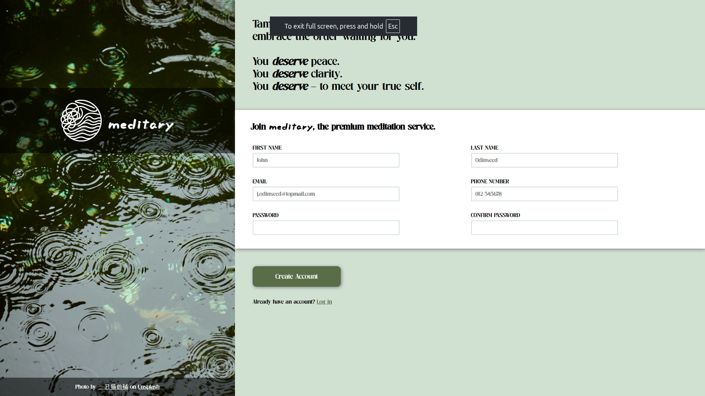

# The Odin Project: Sign-up Form

### Links

Project link: https://www.theodinproject.com/lessons/node-path-intermediate-html-and-css-sign-up-form

Live preview: https://zunaid-hassan.github.io/odin-sign-up-form/

### Description

A stylized sign-up form built for The Odin Project to practice intermediate HTML and CSS. There is no JavaScript in this project. The project focuses on building structured forms and utilizing CSS pseudo-classes to provide real-time visual feedback for user validation and active input states. Validation rules are intentionally simple, to demonstrate `:user-valid` and `:user-invalid` styles. It also implements custom fonts and transparent background overlays to ensure text readability against a large background image.

### Preview

### Credits

Photo by [一只猫的橘](https://unsplash.com/@seelean?utm_source=unsplash&utm_medium=referral&utm_content=creditCopyText) on [Unsplash](https://unsplash.com/photos/raindrops-creating-ripples-on-a-dark-reflective-surface-dmV6wRBzofo?utm_source=unsplash&utm_medium=referral&utm_content=creditCopyText)

Logo generated by Google Gemini.
